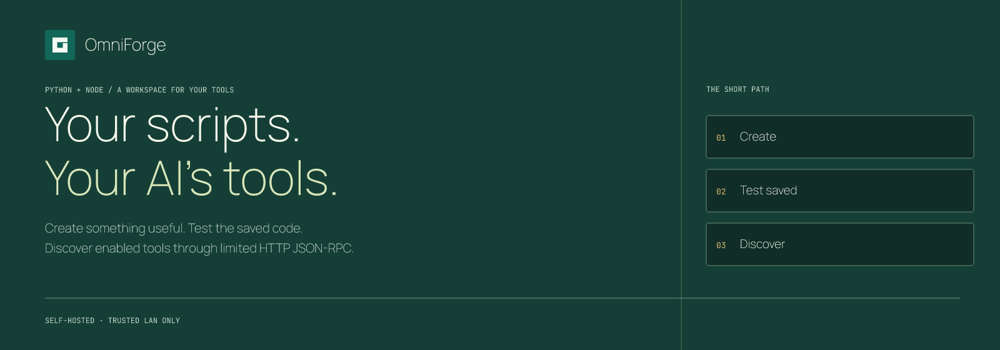
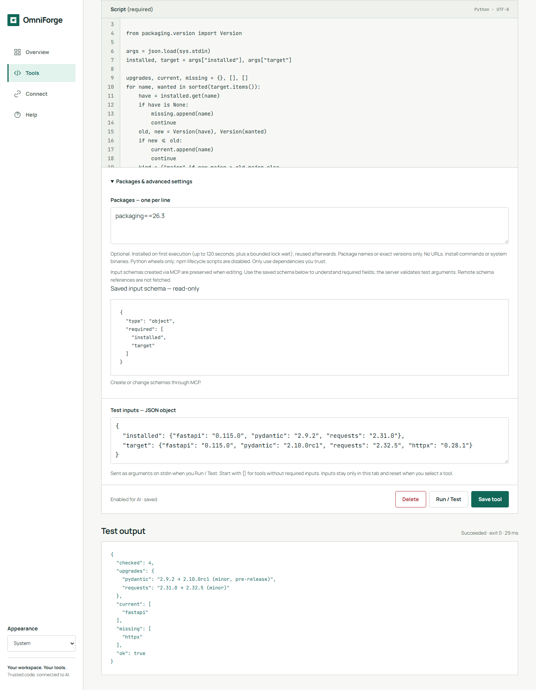

<p align="center"></p>

# OmniForge

**Turn your Python and Node scripts into tools for your AI.**

A self-hosted workspace for trusted code: author a script, save it, test the saved
version with JSON, then let an MCP client discover and call it. One container;
a browser dashboard; your own tool library.

[Get started](#get-started) · [Script examples](examples/README.md) ·
[Documentation](docs/wiki/Home.md) · [Docker Hub](https://hub.docker.com/r/dbzocchi/omniforge)



## Your code, callable by your AI

Use OmniForge for small, focused actions: normalise text, summarise JSON or wrap
an internal task you already trust. Scripts receive one JSON object on stdin and
print their result to stdout. Enabled tools appear on the next `tools/list`;
clients may need a refresh, but the server needs no restart.

**MCP Station connects integrations. OmniForge turns code you author into tools.**
Choose the former to connect services; choose the latter when the action is a
Python or Node script you want to own, test and expose deliberately.

- **Author and organise.** Overview, tool library, Tool studio, Connect and Help;
  light/dark themes, responsive layout and an installable PWA on localhost/HTTPS.
- **Save, then test.** Run / Test executes the saved version and shows stdout,
  stderr, exit code and duration. Saving alone never executes code.
- **Define the contract.** JSON Schema Draft 2020-12 validates inputs before a
  run. Create parameterised tools through the API or built-in authoring helper;
  the dashboard currently preserves schemas but cannot edit them.
- **Keep packages per tool.** Validated pip/npm requirements install on first
  execution into persistent caches. Standard-library tools need no install.
- **Author through MCP too.** `omniforge_instructions` explains the contract;
  `omniforge_create_tool` saves a new tool without running it.

These capabilities describe the reviewed source on this branch, **not a claim
that every published image contains it**. See [image provenance](docs/wiki/Release-and-Deployment.md#published-image-inventory).

## Before you install

> **Single-admin, trusted-network use only.** There are no human logins or user
> accounts. The dashboard and management API are unauthenticated. Scripts share
> the app container, environment, network and writable data; this is **not a
> sandbox**. The optional key protects only `POST /mcp`. Start on localhost;
> never port-forward the service or expose it to cloud clients as-is.
>
> [Security model and limits](docs/wiki/Security-and-Limitations.md) ·
> [Transport and client compatibility](docs/wiki/Connecting-MCP-Clients.md)

## Get started

You need Docker on a Linux/amd64 host. In a **new deployment directory**, generate
an MCP key without putting a credential in the command or Compose file:

```bash
umask 077
printf 'OMNIFORGE_API_KEY=%s\n' "$(openssl rand -hex 32)" > .env
```

Save this as `compose.yaml` alongside `.env`:

```yaml
services:
  omniforge:
    image: dbzocchi/omniforge:latest
    ports:
      - "127.0.0.1:8000:8000"
    environment:
      OMNIFORGE_API_KEY: ${OMNIFORGE_API_KEY:?Generate a key in .env first}
    volumes:
      - omniforge_data:/opt/omniforge/data
      - omniforge_lib:/opt/omniforge/lib
    restart: unless-stopped
volumes:
  omniforge_data:
  omniforge_lib:
```

```bash
docker compose up -d
```

Open **http://localhost:8000** on the Docker host. In the reviewed dashboard,
choose **Start with a template → Python greeting → Save tool → Run / Test**.
Only run scripts you have reviewed and authorised.

**Choose an image deliberately.** On October 16, 2026, Docker Hub had both
`latest` (last published October 13) and `0.2.0_beta` (October 16), each with a
Linux/amd64 runtime image. `latest` is a moving main-channel tag, not a stable
release promise. The beta tag's presence is not feature or compatibility
verification. Pin a tested digest for repeatable deployments.
[Inventory, provenance and upgrades](docs/wiki/Release-and-Deployment.md).

This quickstart uses the published image, **not** the repository's source-build
`docker-compose.yml`. Keep `.env` private and out of version control. Named
volumes persist tools and package caches; [back up the database](docs/wiki/Backup-and-Restore.md).
For source access, Unraid, bind-mount ownership and optional container hardening,
see [Installation](docs/wiki/Installation.md).

## Connect and verify

OmniForge implements **limited HTTP JSON-RPC POST**, not full MCP Streamable
HTTP. The supported methods are `initialize`, `tools/list`, `tools/call` and
`ping`. `GET /mcp` is only a one-event SSE stub. There is no OAuth, session
tracking or tool-list change notification. Third-party client compatibility
must be tested; a client displaying “HTTP” support is not sufficient.

From the deployment directory, using the generated key:

```bash
set -a
. ./.env
set +a
curl --fail-with-body -sS http://localhost:8000/mcp \
  -H 'Content-Type: application/json' \
  -H "Authorization: Bearer $OMNIFORGE_API_KEY" \
  -d '{"jsonrpc":"2.0","id":1,"method":"tools/list","params":{}}'
```

For local or trusted-network clients, follow
[Connecting MCP clients](docs/wiki/Connecting-MCP-Clients.md). The localhost bind
above is intentionally unreachable from another host/container. Remote cloud
connectors need security work beyond these docs—not a tunnel to this open admin
surface.

## Learn, build, operate

| Goal | Guide |
|---|---|
| Make a first working tool | [Getting started](docs/wiki/Getting-Started.md) |
| Try useful dependency-free scripts | [Examples and import payloads](examples/README.md) |
| Understand stdin, stdout and schemas | [Writing tools](docs/wiki/Writing-Tools.md) |
| Look up all routes and request fields | [API reference](docs/wiki/API-Reference.md) |
| Manage packages and failures | [Dependencies](docs/wiki/Dependencies.md) |
| Configure and back up a deployment | [Configuration](docs/wiki/Configuration.md) · [Backup](docs/wiki/Backup-and-Restore.md) |
| Debug or develop | [Troubleshooting](docs/wiki/Troubleshooting-and-FAQ.md) · [Development and testing](docs/wiki/Development-and-Testing.md) |

The [full documentation](docs/wiki/Home.md) retains the detailed dashboard,
architecture, protocol, PWA, security and deployment references. Repository docs
and the site source are **private-access material**, not public hosted help.

## Source and licence

The source repository is private. **All rights reserved**; no open-source licence
is granted by image availability. The Python image includes application source,
so repository privacy does not make that distributed code confidential. Review
image contents before publishing. Bundled Manrope and JetBrains Mono fonts have
separate SIL Open Font Licence texts in `app/static/fonts/`.
