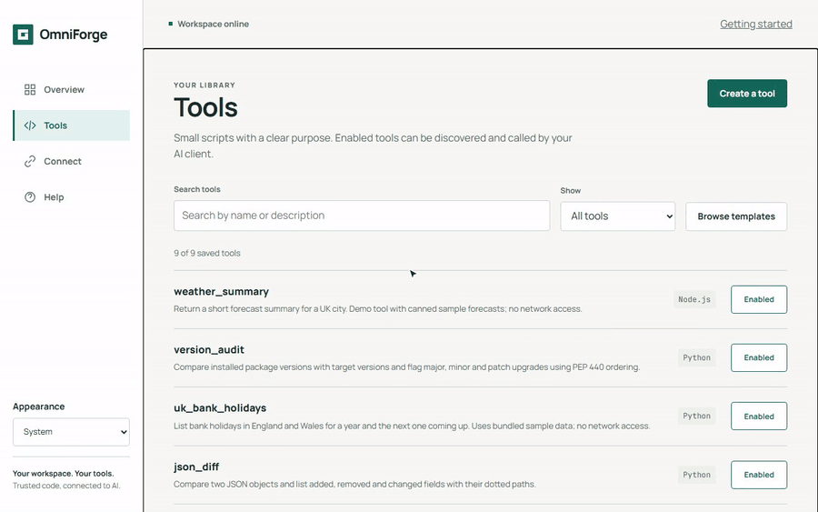

<p align="center"></p>

<h1 align="center">OmniForge</h1>

<p align="center"><strong>Write a Python or Node script, test it with JSON, and publish it as an MCP tool, all from one self-hosted container.</strong></p>

<p align="center">
  <a href="https://hub.docker.com/r/dbzocchi/omniforge"></a>
  <a href="https://hub.docker.com/r/dbzocchi/omniforge"></a>
  
  
  
  
</p>

> [!CAUTION]
> **Trusted LAN only.** The dashboard and management API have **no authentication**. Scripts run as subprocesses **inside the app container**, with its full environment (including `OMNIFORGE_API_KEY`), network and data. There's no per-run isolation. Don't expose OmniForge to the internet. See [Security model and limitations](#security-model-and-limitations).

## Contents

- [What it is](#what-it-is)
- [Features](#features)
- [Quick start](#quick-start)
- [Connect an MCP client](#connect-an-mcp-client)
- [Configuration](#configuration)
- [Data and volumes](#data-and-volumes)
- [Security model and limitations](#security-model-and-limitations)
- [Architecture](#architecture)
- [Development and tests](#development-and-tests)
- [Release and deployment](#release-and-deployment)
- [Documentation](#documentation)
- [Licence](#licence)

## What it is

OmniForge is a small web workspace for giving an AI assistant new abilities. Each ability is a **tool**: a short Python or Node script that reads a JSON object on stdin and prints its result. You write the script in the browser, test it with sample input, and save it. Its name, description and input schema are listed straight away at `/mcp`, where MCP clients such as Claude Code or LibreChat can discover and call it. There's nothing to restart.

<p align="center"></p>

<p align="center"></p>

## Features

- **Five-screen dashboard:** Overview, Tools, Tool studio, Connect and Help. Light, dark and system themes, keyboard support, mobile layout, and an installable PWA.
- **Python 3.12 and Node.js tools:** arguments arrive as one JSON object on stdin, never through a shell. stdout comes back as MCP text.
- **Run / Test in the browser** against the saved version, showing stdout, stderr, the exit code and the duration.
- **Instant publishing:** the tool list is read from SQLite on each request, so saved, enabled tools appear on the client's next `tools/list`.
- **Input validation:** JSON Schema Draft 2020-12, local references only, checked before any code runs.
- **Lazy, per-tool packages:** up to 50 pip or npm packages per tool, installed on first run into a persistent cache. Wheels only, no npm lifecycle scripts, strict package names.
- **Built-in authoring tools:** `omniforge_instructions` and `omniforge_create_tool` let an AI client learn the contract and save new tools, with saving kept separate from running.
- **Safe concurrent editing:** content revisions and `If-Match` stop a stale tab overwriting, deleting, toggling or testing a changed tool (HTTP 412).
- **One container, non-root (UID 1000):** works with a read-only root filesystem, a `noexec` `/tmp` and all capabilities dropped. Doesn't need the Docker socket.

## Quick start

You'll need Docker on an `amd64` host. Generate a key for the MCP endpoint first:

```bash
openssl rand -hex 32
```

### Docker Compose (published image)

```yaml
# compose.yaml
services:
  omniforge:
    image: dbzocchi/omniforge:latest   # or pin: dbzocchi/omniforge@sha256:<digest>
    container_name: omniforge
    ports:
      - "8000:8000"
    environment:
      OMNIFORGE_API_KEY: ${OMNIFORGE_API_KEY:-}
    volumes:
      - omniforge_data:/opt/omniforge/data
      - omniforge_lib:/opt/omniforge/lib
    read_only: true                      # optional hardening (protects the host,
    tmpfs:                               # not one script from another)
      - /tmp:rw,noexec,nosuid,size=128m
    cap_drop: [ALL]
    security_opt: ["no-new-privileges:true"]
    restart: unless-stopped

volumes:
  omniforge_data:
  omniforge_lib:
```

```bash
echo "OMNIFORGE_API_KEY=<your-random-key>" > .env
docker compose up -d
```

The repository's own `docker-compose.yml` **builds from source** instead (`docker compose up --build`), after `cp .env.example .env`. Replace the example key `change-me` before you start it.

### docker run

```bash
docker run -d --name omniforge \
  -p 8000:8000 \
  -e OMNIFORGE_API_KEY='<your-random-key>' \
  -v omniforge_data:/opt/omniforge/data \
  -v omniforge_lib:/opt/omniforge/lib \
  --restart unless-stopped \
  dbzocchi/omniforge:latest
```

### From source (Linux, macOS or WSL)

```bash
python3 -m venv .venv && source .venv/bin/activate
pip install -r requirements.txt
mkdir -p omniforge_data omniforge_lib
export OMNIFORGE_DB_PATH="$PWD/omniforge_data/omniforge.db" OMNIFORGE_LIB_ROOT="$PWD/omniforge_lib"
uvicorn app.main:app --host 127.0.0.1 --port 8000 --reload
```

Then open **`http://localhost:8000`**. Choose **Start with a template → Python greeting → Save tool → Run / Test**. The MCP endpoint is `http://localhost:8000/mcp`.

Unraid, hardening and bind-mount ownership are covered in [Installation](docs/wiki/Installation.md). A guided first run is in [Getting started](docs/wiki/Getting-Started.md).

## Connect an MCP client

The server accepts **JSON-RPC 2.0 over `POST /mcp`**: `initialize`, `tools/list`, `tools/call` and `ping`. When `OMNIFORGE_API_KEY` is set, it also requires `Authorization: Bearer <key>`. It is **not** full Streamable HTTP: there are no sessions, SSE responses, notifications or OAuth. **No third-party client has been verified** against it, so check yours with a `tools/list` first.

**Claude Code**

```bash
claude mcp add --transport http omniforge http://your-host:8000/mcp \
  --header "Authorization: Bearer <YOUR_API_KEY>"
```

```json
{
  "mcpServers": {
    "omniforge": {
      "type": "http",
      "url": "http://your-host:8000/mcp",
      "headers": { "Authorization": "Bearer ${OMNIFORGE_API_KEY}" }
    }
  }
}
```

**Claude Desktop**: `claude_desktop_config.json` starts stdio servers, so use the community `mcp-remote` bridge:

```json
{
  "mcpServers": {
    "omniforge": {
      "command": "npx",
      "args": ["-y", "mcp-remote", "http://your-host:8000/mcp", "--allow-http",
               "--transport", "http-only", "--header", "Authorization:${AUTH_HEADER}"],
      "env": { "AUTH_HEADER": "Bearer <YOUR_API_KEY>" }
    }
  }
}
```

**LibreChat** (`librechat.yaml`)

```yaml
mcpServers:
  omniforge:
    type: streamable-http
    url: http://your-host:8000/mcp
    headers:
      Authorization: "Bearer ${OMNIFORGE_API_KEY}"
    timeout: 120000
```

**Plain HTTP**

```bash
curl -s http://your-host:8000/mcp \
  -H 'Content-Type: application/json' \
  -H 'Authorization: Bearer <YOUR_API_KEY>' \
  -d '{"jsonrpc":"2.0","id":1,"method":"tools/call","params":{"name":"example_python_basic","arguments":{}}}'
```

Leave out the `Authorization` header or line if you didn't set a key. Use a hostname the client can reach (`localhost` won't work from another machine or container). Refresh the client after adding or enabling tools, because OmniForge sends no change notifications. Details and troubleshooting are in [Connecting MCP clients](docs/wiki/Connecting-MCP-Clients.md) and [MCP protocol support](docs/wiki/MCP-Protocol-Support.md).

## Configuration

All settings are environment variables, read once at start-up. Recreate the container after changing them.

| Variable | Default | Description |
|---|---|---|
| `OMNIFORGE_API_KEY` | *(empty)* | Bearer key required on `POST /mcp`. Empty disables MCP auth. Doesn't protect the dashboard, `/api/*` or `GET /mcp`. **Visible to every script.** |
| `OMNIFORGE_DB_PATH` | `/opt/omniforge/data/omniforge.db` | SQLite database file. |
| `OMNIFORGE_LIB_ROOT` | `/opt/omniforge/lib` | Writable, persistent per-tool pip and npm caches. Must be writable by UID 1000. |
| `OMNIFORGE_SCRATCH_ROOT` | `/tmp/omniforge` | Shared directory where scripts are written and run. |
| `OMNIFORGE_MAX_SCRIPT_TIMEOUT_MS` | `30000` | Script timeout in ms. The runner **adds 15 s** (45 s effective), counted after dependency preparation. |
| `OMNIFORGE_MAX_SCRIPT_MEMORY_MB` | `512` | **Declared only, not enforced.** Use Docker's `--memory`. |
| `OMNIFORGE_CACHE_TTL_MS` | `5000` | Lifetime of the in-process tool-list cache. Writes clear it immediately in the same process. |
| `OMNIFORGE_SCRIPT_HOST` | `/opt/omniforge/scripts` | Historical. **Unused**: the runner uses `OMNIFORGE_SCRATCH_ROOT`. |
| `OMNIFORGE_RUNTIME_IMAGE` | (set in `docker-compose.yml`) | Historical. **Unused.** |

Test-only variables (`OMNIFORGE_LIVE_INSTALL_TESTS`, `OMNIFORGE_SCREENSHOTS`, `OMNIFORGE_TEST_PYTHON`) and the variables the image sets are listed in [Configuration](docs/wiki/Configuration.md).

## Data and volumes

| Container path | Contents | Persist |
|---|---|---|
| `/opt/omniforge/data` | `omniforge.db`: every tool's name, description, runtime, code, packages, schema and enabled state | **Yes, back this up** |
| `/opt/omniforge/lib` | `<sha256(tool id)>/<python3\|node>/<sha256(requirements)>/` package caches | Recommended (rebuildable) |
| `/tmp/omniforge` | Scratch copies of scripts (`<tool-id>.py` or `.js`), the run working directory | No (tmpfs is fine) |
| `/opt/omniforge/scripts` | Nothing. A legacy mount in the repository's compose file | No |

Both persistent paths must be writable by **UID 1000**. Named volumes inherit this from the image, but bind mounts need `chown -R 1000:1000`. SQLite runs in rollback-journal mode, so take consistent backups with SQLite's backup API or with the container stopped. See [Backup and restore](docs/wiki/Backup-and-Restore.md).

## Security model and limitations

OmniForge is a **trusted-LAN tool for trusted authors**. It makes no claim of isolation or production-grade security.

| Area | Reality today |
|---|---|
| Dashboard and `/api/*` | **No authentication.** Anyone who can reach the port can read every tool's code, and create, edit, delete and run tools. |
| `POST /mcp` | Optional static Bearer key. Holding it means code execution, because `omniforge_create_tool` plus `tools/call` runs arbitrary code. |
| `GET /mcp` | **Unauthenticated** stub event stream: one event, then it closes. |
| FastAPI `/docs`, `/redoc`, `/openapi.json` | Enabled and unauthenticated. |
| Script isolation | **None.** Scripts are subprocesses of the app, with the same UID and a copy of its **entire environment, including `OMNIFORGE_API_KEY`**, which a tool can print. They can read and write the database, other tools' caches and `/tmp`, and reach the network. |
| Availability | The run and MCP handlers are `async` but call blocking `subprocess.run` and pip/npm installs on a single worker. **One slow tool stalls the whole server.** |
| Resource limits | Timeout = configured + 15 s, and it **kills only the direct child**, so grandchildren survive. **Output isn't capped.** **The memory setting isn't enforced.** No CPU or rate limits. |
| MCP transport | Handwritten and partial, not full Streamable HTTP. No OAuth, sessions, notifications or batching. The official `mcp` SDK is installed but unused for the transport. |
| Browser attacks | No CSRF, `Origin` or `Host` checks. A malicious page opened on your LAN could toggle tools or run tools that take no inputs. |
| Dashboard schemas | The dashboard **can't edit input schemas**, so tools made in the browser take no parameters unless created through the API or `omniforge_create_tool`. |
| PWA | Installation and the offline page need **HTTPS or `localhost`**. Plain HTTP LAN addresses work as a website only. |

Measures that **are** in place: arguments via stdin (no shell), strict name, package and schema validation before execution, a scrubbed installer environment with redacted errors, atomic non-destructive caches, `If-Match` revision guards, a 14-file static allow-list, a `textContent`-only dashboard, a public-assets-only service-worker cache, parameterised SQL, and a non-root image that supports a read-only root.

**Deploy on a trusted network only, keep other secrets out of the container's environment, set `--memory` and `--cpus` limits, and never port-forward it.** The full threat model and checklist are in [Security and limitations](docs/wiki/Security-and-Limitations.md).

## Architecture

```text
Browser (dashboard / PWA)          MCP client
   │  GET / · /api/* · /assets/*      │  POST /mcp (JSON-RPC)
   └──────────────┬───────────────────┘
                  ▼
   uvicorn (1 worker) → app/main.py ─── routes, Bearer check, JSON-RPC dispatch
                  ├── app/mcp_server.py    built-ins, tools/list, tools/call, initialize
                  ├── app/tool_authoring.py validation (names, schemas, args) + save-only
                  ├── app/database.py      SQLite (BEGIN IMMEDIATE, revisions) + 5 s list cache
                  └── app/runner.py        python3 / node subprocess, stdin JSON, timeout
                         └── app/dependencies.py  lazy per-tool pip/npm caches (fcntl lock, atomic)
```

There's no framework or build step on the frontend: `app/templates/dashboard.html` holds one inline script, plus `app/static/` (CSS, self-hosted Manrope and JetBrains Mono, icons, manifest, `sw.js`). Diagrams and request flows are in [Architecture](docs/wiki/Architecture.md). The design rationale is in [docs/product-design.md](docs/product-design.md).

## Development and tests

CI (`.github/workflows/test.yml`) runs these on every pull request and on pushes to non-`main` branches:

```bash
# Dashboard script and service-worker syntax, then dependency-free DOM and worker tests
python3 - <<'PY'
from pathlib import Path
page = Path('app/templates/dashboard.html').read_text()
Path('/tmp/dashboard.js').write_text(page.split('<script>', 1)[1].split('</script>', 1)[0])
PY
node --check /tmp/dashboard.js
node --check app/static/sw.js
node --test tests/dashboard_ui.cjs tests/service_worker.cjs

# Python suite inside the real image
docker build -t omniforge:test .
docker run --rm -v "$PWD/tests:/app/tests:ro" omniforge:test python -m unittest discover -s tests -v

# Browser and accessibility suite (Playwright + axe; starts its own temporary server)
python -m venv .venv
.venv/bin/pip install -r requirements.txt
npm ci --ignore-scripts
npx playwright install --with-deps chromium
OMNIFORGE_SCREENSHOTS=test-artifacts/screenshots npm run test:browser
```

Opt-in live pip and npm installs: add `-e OMNIFORGE_LIVE_INSTALL_TESTS=1` to the `docker run` above and use `-p 'test_live_examples.py'`. More in [Development and testing](docs/wiki/Development-and-Testing.md).

## Release and deployment

- Pushing to `main` (when `Dockerfile`, `requirements.txt`, `app/**` or the workflows change), or a manual dispatch, runs `.github/workflows/dockerhub.yml`. That builds the image and pushes **`dbzocchi/omniforge:latest`** for **`linux/amd64`**.
- **`latest` is the only tag.** For reproducible deploys and rollbacks, **pin by digest**:

  ```bash
  docker buildx imagetools inspect dbzocchi/omniforge:latest   # shows the sha256 digest
  ```

  ```yaml
  image: dbzocchi/omniforge@sha256:<digest>
  ```

- Tests run on pull requests, not on the push to `main`, so merge through a PR.
- There are no database migrations. Updating is: back up, pull, recreate.
- When a public asset changes, bump the `CACHE` name in `app/static/sw.js`.

Manual build: `docker buildx build --platform linux/amd64 -t dbzocchi/omniforge:latest --push .`. See [Release and deployment](docs/wiki/Release-and-Deployment.md).

## Documentation

The full documentation lives in [`docs/wiki/`](docs/wiki/Home.md) and reads directly in the repository browser:

| Using | Operating | Reference |
|---|---|---|
| [Getting started](docs/wiki/Getting-Started.md) | [Security and limitations](docs/wiki/Security-and-Limitations.md) | [Architecture](docs/wiki/Architecture.md) |
| [Installation](docs/wiki/Installation.md) | [Backup and restore](docs/wiki/Backup-and-Restore.md) | [API reference](docs/wiki/API-Reference.md) |
| [Configuration](docs/wiki/Configuration.md) | [Troubleshooting and FAQ](docs/wiki/Troubleshooting-and-FAQ.md) | [MCP protocol support](docs/wiki/MCP-Protocol-Support.md) |
| [Dashboard guide](docs/wiki/Dashboard-Guide.md) | [Release and deployment](docs/wiki/Release-and-Deployment.md) | [Development and testing](docs/wiki/Development-and-Testing.md) |
| [Writing tools](docs/wiki/Writing-Tools.md) | | [Glossary](docs/wiki/Glossary.md) |
| [Dependencies](docs/wiki/Dependencies.md) | | [Product design notes](docs/product-design.md) |
| [Testing tools](docs/wiki/Testing-Tools.md) | | |
| [Connecting MCP clients](docs/wiki/Connecting-MCP-Clients.md) | | |
| [Built-in authoring tools](docs/wiki/Built-in-Authoring-Tools.md) | | |
| [PWA and themes](docs/wiki/PWA-and-Themes.md) | | |

A landing page is ready in [`docs/index.html`](docs/index.html) for when hosting becomes available.

## Licence

Private. All rights reserved.

The bundled Manrope and JetBrains Mono fonts are used under the SIL Open Font Licence. Their licence texts are in `app/static/fonts/`.
