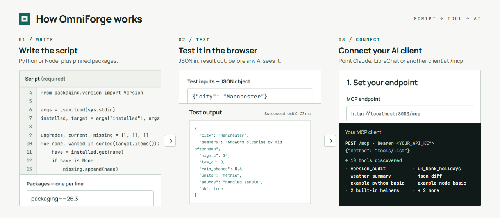
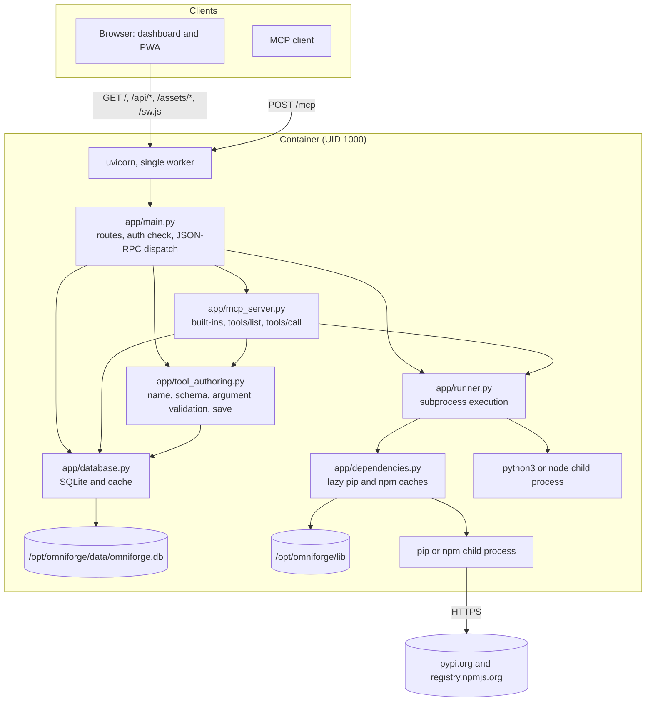
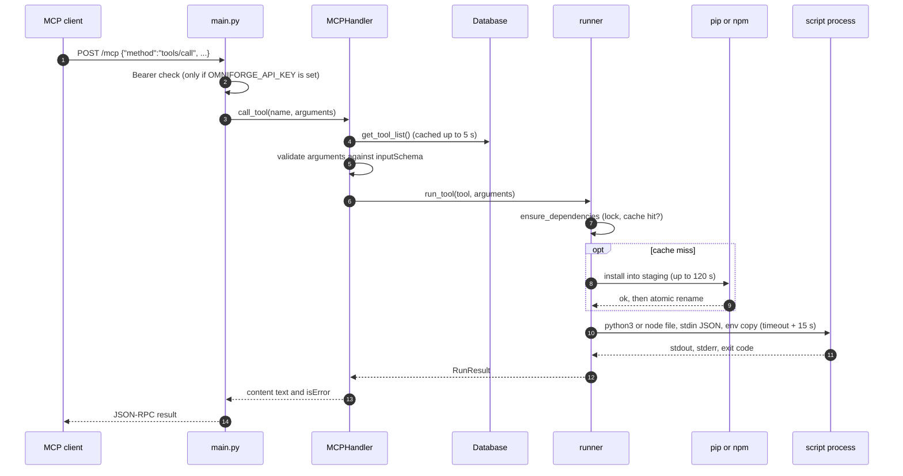
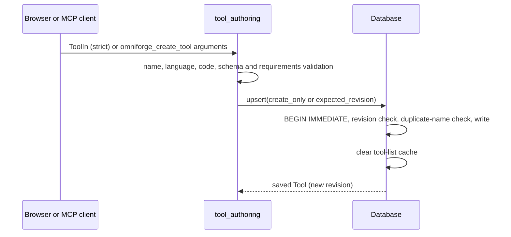

# Architecture

OmniForge is one FastAPI application, served by one uvicorn worker in one container. It stores tools in SQLite and runs them as child processes of itself. There's no message queue, no separate runner service, no frontend build step and no external database.

<p align="center"></p>

## Components



## Modules

| Module | Responsibility |
|---|---|
| `app/main.py` | The FastAPI app. Dashboard HTML, allow-listed static assets, the service worker, `/api/config`, tool CRUD, toggle and run routes, `POST /mcp` with the Bearer check and method dispatch, and the `GET /mcp` stub. |
| `app/mcp_server.py` | `MCPHandler`. Lists the two built-in tools plus active database tools, calls built-ins or runs scripts, formats results as MCP text content, and answers `initialize`. Holds the `INSTRUCTIONS` document and the `omniforge_create_tool` schema. |
| `app/tool_authoring.py` | Shared rules for the dashboard and MCP: the `ToolIn` model (strict, no extra fields), name regex and reserved names, language normalisation, Draft 2020-12 schema checks with local references only, argument validation, and `save_tool()`, which saves metadata and **never** executes. |
| `app/runner.py` | `run_tool()`. Picks the interpreter, prepares dependencies, copies the environment, writes the script to the scratch directory, runs it with stdin JSON and a timeout, and returns `RunResult`. |
| `app/dependencies.py` | Requirement validation, a per-tool and per-requirement-set cache with `fcntl` locks, a scrubbed installer environment, atomic publication and bounded, redacted error output. |
| `app/database.py` | `Database`. Schema creation, a five-second tool-list cache invalidated on every write, `BEGIN IMMEDIATE` transactions, duplicate-name and revision guards. |
| `app/templates/dashboard.html` | The entire dashboard: semantic HTML and one inline script. No framework, no build step and no runtime frontend dependencies. |
| `app/static/` | `product.css`, fonts, icons, the manifest, `offline.html` and `sw.js`. |

### Python dependencies

`requirements.txt` lists `fastapi`, `uvicorn[standard]`, `pydantic`, `pydantic-settings`, `mcp`, `sse-starlette` and `slowapi`, all unpinned. The app imports only FastAPI, Starlette (via FastAPI), Pydantic, **`jsonschema`** and **`referencing`**. The last two aren't listed directly: they arrive as dependencies of `mcp`.

- `mcp`, the official MCP Python SDK, is **installed but not used** for the transport, which is handwritten in `main.py` and `mcp_server.py`. Removing it from `requirements.txt` would currently break schema validation.
- `pydantic-settings`, `sse-starlette` and `slowapi` aren't imported anywhere.

## Request flows

### MCP `tools/call`



Every step after the HTTP request arrives is **synchronous on the event loop**. Nothing else is served until the response is sent.

### Dashboard Run / Test

`POST /api/tools/{name}/run` follows the same path, with three differences:

1. It reads the tool **fresh** from SQLite, bypassing the cache, so a stale cache in another worker can't run old code.
2. It checks `If-Match` against the tool's revision first (HTTP 412 on a mismatch).
3. It returns structured `stdout`, `stderr`, `exit_code`, `timed_out` and `duration_ms` instead of MCP text. It also runs disabled tools.

### Saving a tool



Nothing is executed or installed on save.

## Data model

The `Tool` dataclass maps one-to-one to the `tools` table (see [Backup and restore](Backup-and-Restore.md#what-to-back-up)), plus one computed field:

- **`revision`**: a SHA-256 of `[id, name, description, language, code, requirements_json, json_schema_json, is_active]`. It changes whenever content or the enabled state changes. Timestamps aren't included. The dashboard sends it as `If-Match`, and update, delete and toggle compare it inside the write transaction.

IDs are the first 12 hex characters of a UUID4. Names are unique for new writes, enforced in a serialised transaction. The database index isn't unique, so duplicate rows left by old versions are kept, never deleted.

## Hot reload

There's no tool registry to rebuild. `tools/list` reads the database on each request, through a cache that every write in the same process clears immediately. Across separate processes the cache can be up to `OMNIFORGE_CACHE_TTL_MS` (5 s) stale. A saved, enabled tool is therefore callable on the client's next `tools/list`, with no restart.

## Execution model

| Aspect | Design |
|---|---|
| Process | `subprocess.run([interpreter, scratch_file], input=json, capture_output=True, timeout=…)` |
| Interpreter | `shutil.which("python3")` (the venv interpreter in the image) or `shutil.which("node")` |
| Scratch file | `$OMNIFORGE_SCRATCH_ROOT/<tool-id>.py` or `.js`, overwritten on each run and never deleted |
| Environment | `os.environ.copy()`, with the dependency directory put in front of `PYTHONPATH` or `NODE_PATH` |
| Timeout | `MAX_TIMEOUT_MS / 1000 + 15` s. Kills the direct child only |
| Output | Fully buffered in memory and stripped |
| Isolation | None (see [Security and limitations](Security-and-Limitations.md)) |

An early version started a throwaway container for each run through the Docker CLI, with CPU and memory caps. Commit `aa28600` ("Switch runner to in-process execution with timeout, drop docker dependency") replaced that with the subprocess model above. That's why `OMNIFORGE_RUNTIME_IMAGE` and `OMNIFORGE_SCRIPT_HOST` still appear in the repository's compose file but do nothing, and why the old per-run limits are gone.

## Frontend

- One HTML document with an inline script, using hash routes (`#overview`, `#tools`, `#tools/new`, `#tools/edit/<name>`, `#connect`, `#help`).
- All dynamic content is set with `textContent`, and the template contains no `innerHTML`.
- State lives in memory: tool list, current draft, test inputs, last output. Only the theme is written to `localStorage`.
- `sw.js` precaches 12 public assets and serves an offline page for failed navigations. It never caches HTML or API responses. See [PWA and themes](PWA-and-Themes.md).
- Design rationale is in the [product design notes](../product-design.md).

## Repository layout

```text
omniforge/
├── app/
│   ├── main.py              # FastAPI routes, auth check, JSON-RPC dispatch
│   ├── mcp_server.py        # built-ins, tools/list, tools/call, initialize
│   ├── tool_authoring.py    # shared validation and save-only helper
│   ├── runner.py            # subprocess execution
│   ├── dependencies.py      # lazy per-tool pip and npm caches
│   ├── database.py          # SQLite storage and cache
│   ├── templates/dashboard.html
│   └── static/              # CSS, fonts, icons, manifest, offline page, service worker
├── tests/                   # Python unittest, Node DOM, worker and Playwright suites
├── docs/
│   ├── product-design.md
│   ├── wiki/                # these pages
│   ├── assets/              # banner, diagrams, screenshots
│   └── index.html           # landing page (not yet hosted)
├── .github/workflows/       # test.yml, dockerhub.yml
├── Dockerfile
├── docker-compose.yml
├── requirements.txt
└── package.json             # development-only browser test tooling
```

---

← [Home](Home.md) · [Next: API reference →](API-Reference.md)
