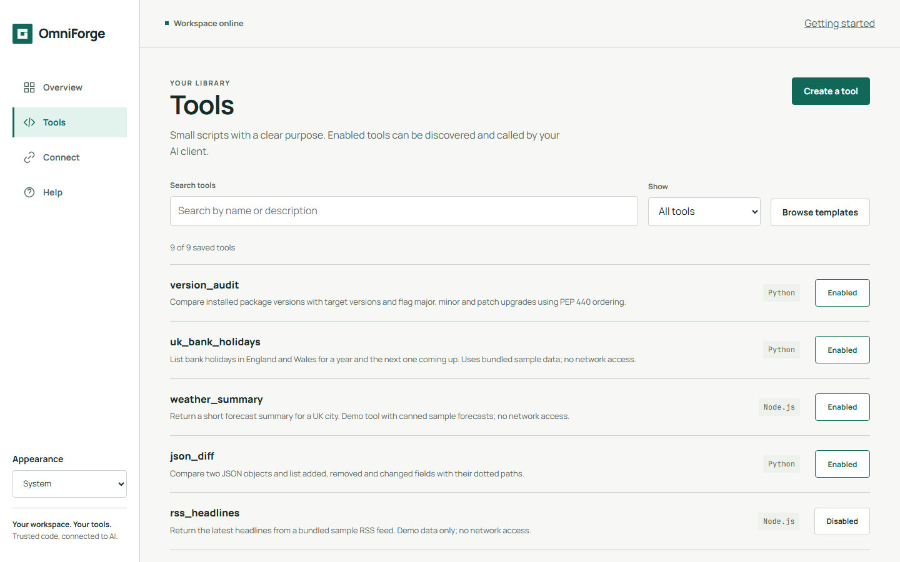
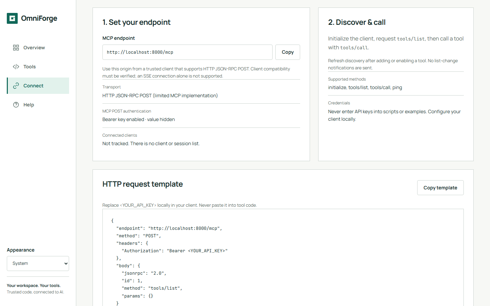
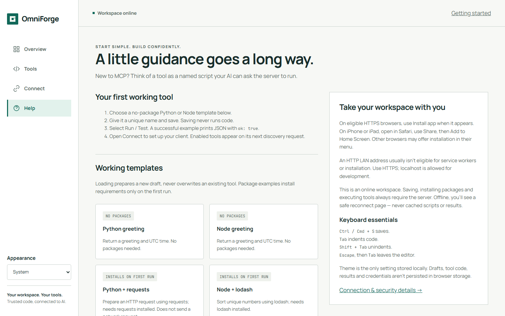
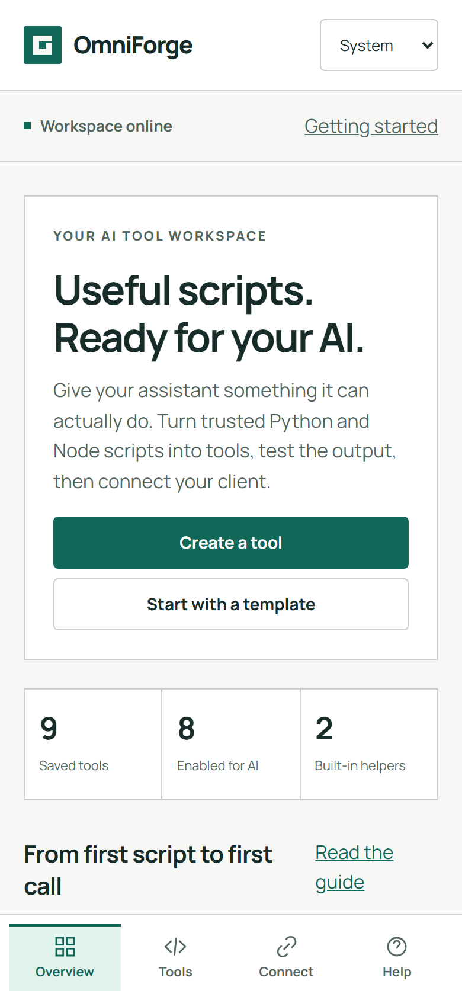
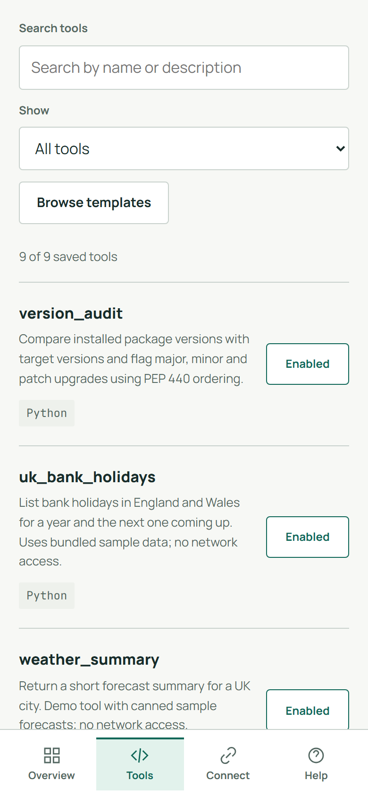
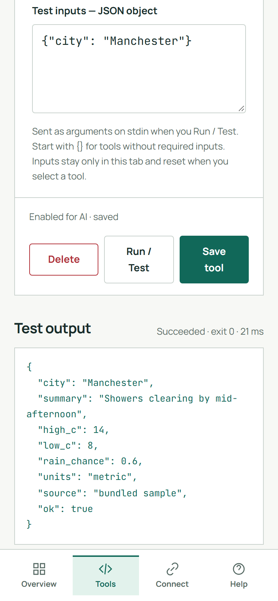

# Dashboard guide

The dashboard is OmniForge's single web page at `/`. It has five screens: **Overview**, **Tools**, **Tool studio**, **Connect** and **Help**. You move between them with the left-hand rail on desktop, or the four-item bottom bar on a phone. The Tool studio opens from Tools.

Every screen has its own address, so you can bookmark it or use the browser's back button:

| Screen | Address |
|---|---|
| Overview | `/#overview` |
| Tools | `/#tools` |
| Tool studio (new) | `/#tools/new` |
| Tool studio (edit) | `/#tools/edit/<name>` |
| Connect | `/#connect` |
| Help | `/#help` |

> [!NOTE]
> Nobody signs in to the dashboard. Anyone who can open the page can create, change, run and delete tools. That's why OmniForge belongs on a trusted network only.

## The frame around every screen

- **Top bar.** A connection indicator (**Workspace online**, **Server unavailable** or **Offline**), an **Install app** button when your browser offers installation, an **Update available** button when a new version is waiting, and a **Getting started** link.
- **Offline banner.** Appears when your device loses its connection. Your open draft stays in the tab, but saving, running and toggling are disabled until you reconnect.
- **Appearance.** At the bottom of the desktop rail, or top right on a phone: **System**, **Light** or **Dark**. See [PWA and themes](PWA-and-Themes.md).
- **Notifications** appear bottom right. Success messages fade after 7 seconds; errors stay until you dismiss them.

## Overview

The Overview is the home screen.

- **Create a tool** opens an empty Tool studio. **Start with a template** opens the template picker.
- **Saved tools** and **Enabled for AI** are live counts from your library. **Built-in helpers** is always 2. The dashboard doesn't track connected clients or a run history.
- **From first script to first call** walks you through the three steps: create, test and connect.
- **Built for a trusted workspace** is a reminder of the security model.

## Tools

Your library of saved scripts.

| Control | What it does |
|---|---|
| **Search tools** | Filters by name or description as you type. |
| **Show** | All tools, Enabled, Disabled, Python or Node. |
| **Browse templates** | Opens the four working templates. |
| Tool row | Select the name to open it in the Tool studio. The badge shows the runtime. |
| **Enabled / Disabled** switch | Turns MCP discovery on or off for that tool. A disabled tool stays saved and editable, but `tools/list` leaves it out and `tools/call` refuses it. Toggling never changes code. |

The count line reads, for example, "3 of 5 saved tools". The note **Two helpers, always available** refers to the built-in `omniforge_instructions` and `omniforge_create_tool`. They aren't in the library and can't be edited, toggled or shadowed. See [Built-in authoring tools](Built-in-Authoring-Tools.md).

## Tool studio

The studio is where you write, save and test one tool at a time.

| Field | Notes |
|---|---|
| **Tool name** (required) | Starts with a letter, then up to 62 letters, digits, `_` or `-`. This is the name the AI client calls. It must be unique, even among disabled tools. |
| **Runtime** | Python 3 or Node.js. Node scripts use CommonJS (`require`). |
| **What does it do?** | The description sent to AI clients. Write it for the assistant: when should it use this tool? |
| **Script** (required) | Code editor with line numbers. `Tab` indents and `Shift`+`Tab` unindents. To leave the editor with the keyboard, press `Escape` then `Tab`. |
| **Packages & advanced settings** | One package per line, such as `requests==2.32.5` or `lodash@4.17.21`. Installed on the first run, not on save. See [Dependencies](Dependencies.md). This section also shows the **saved input schema, read-only**. |
| **Test inputs** | A JSON object sent to the script on stdin when you select Run / Test. Defaults to `{}`. It stays only in this tab. |

### Buttons and states

- **Save tool** (`Ctrl`/`Cmd`+`S`) stores the tool. It never runs code or installs packages.
- **Run / Test** runs the **saved** version with your Test inputs. It's disabled while there are unsaved changes ("Unsaved changes · save before testing").
- **Delete** asks for confirmation, then removes the tool permanently.
- The state line reads **New draft · not saved**, **Unsaved changes**, **Enabled for AI · saved**, **Disabled for AI · saved** or **Working… Keep this tab open.**

If you try to leave with unsaved edits, whether by navigating, reloading, closing the tab or going back in the browser, the studio asks for confirmation first.

### Test output

The output panel shows stdout, pretty-printed if it's valid JSON, followed by any `[stderr]`. The summary reads, for example, **Succeeded · exit 0 · 182 ms**, **Failed · exit 1 · 95 ms** or **Failed · exit 124 · 45031 ms · timeout**. If you edit the code or the inputs after a run, or the tool changes elsewhere, the summary is prefixed **Previous version / inputs** so you never mistake an old result for a current one.

### Limits worth knowing

- **Input schemas can't be edited here.** A tool created in the studio has an empty schema, so it accepts only `{}`. Schemas created through the API or `omniforge_create_tool` are kept when you edit and save in the studio. See [Writing tools → Giving a tool inputs](Writing-Tools.md#giving-a-tool-inputs).
- **Another tab changed it?** Saves, tests, toggles and deletes carry the tool's revision. If someone else changed the tool first, you get *HTTP 412: Changed in another tab/client; draft retained*. Copy your draft, then reload the tool from the library.
- **Drafts aren't stored.** Reloading the page loses unsaved work, after a warning.

## Connect

Everything a client needs, read from `GET /api/config`:

- **MCP endpoint**: built from the address in your browser bar, plus `/mcp`, with a **Copy** button. If you opened the dashboard through `localhost`, clients on other machines need your host's real name or IP instead.
- **Transport**: "HTTP JSON-RPC POST (limited MCP implementation)".
- **MCP POST authentication**: **Bearer key enabled · value hidden**, or **Disabled — no Bearer key required**.
- **Connected clients**: "Not tracked." There is no session list.
- **Supported methods**: `initialize`, `tools/list`, `tools/call`, `ping`.
- **HTTP request template**: a copyable `tools/list` request, with `Bearer <YOUR_API_KEY>` as a placeholder.

Client set-up is in [Connecting MCP clients](Connecting-MCP-Clients.md).

## Help

| Section | Contents |
|---|---|
| **Your first working tool** | The four-step first-run checklist. |
| **Working templates** | Python greeting, Node greeting, Python + requests and Node + lodash. Each one opens as a new draft and never overwrites a saved tool. |
| **Add all missing examples** | Saves any of the four examples (`example_python_basic`, `example_node_basic`, `example_python_requests`, `example_node_lodash`) whose names don't exist yet. Existing names are skipped and nothing runs. |
| **Write for a predictable result** | The stdout and stdin rules, in short. |
| **When something goes wrong** | Common fixes. More in [Troubleshooting](Troubleshooting-and-FAQ.md). |
| **Take your workspace with you** | Installing the app, HTTPS requirements and keyboard shortcuts. |

## On a phone

  
  
  

The rail becomes a bottom bar with four labelled destinations: Overview, Tools, Connect and Help. It respects the safe-area inset on notched phones. Every control is at least 44 px tall, and nothing depends on hover.

## Accessibility

- A skip link, landmarks and `aria-current` on the active destination.
- Visible focus rings, native `<dialog>` confirmations and live regions for status messages.
- Reduced motion is respected.
- Automated axe WCAG A/AA checks run at 375, 768 and 1440 px in both themes. A manual screen-reader review hasn't been done yet. See the [product design notes](../product-design.md#repeatable-validation).

---

← [Home](Home.md) · [Next: Writing tools →](Writing-Tools.md)
