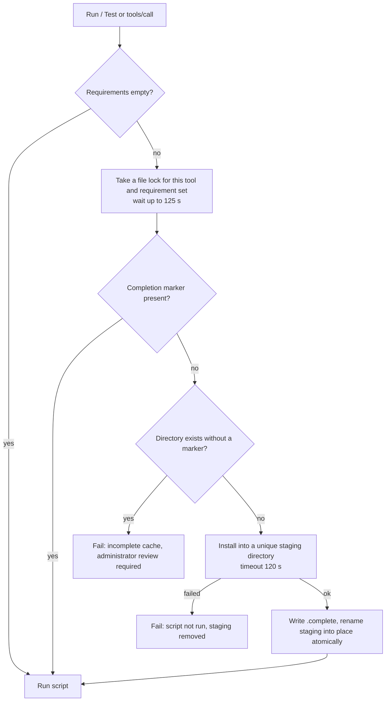

# Dependencies

A tool can declare up to **50 packages**. OmniForge checks the names when you save, but installs nothing until the tool **first runs**. It then installs them into a cache that belongs to that tool and reuses the cache on every later run.

## Declaring packages

- **Dashboard:** Tool studio → **Packages & advanced settings**, one package per line.
- **REST API:** `"requirements": ["requests==2.32.5"]`.
- **MCP:** `omniforge_create_tool` with `"requirements": ["lodash@4.17.21"]`.

Duplicates are removed and the list is sorted before saving, so `["b", "a", "a"]` and `["a", "b"]` describe the same environment.

## Accepted forms

### Python (pip, wheels only)

| Form | Example | Accepted |
|---|---|---|
| Name | `requests` | Yes |
| Exact version | `requests==2.32.5` | Yes |
| Pre-release, post or dev pin with no separator | `pillow==11.0.0rc1`, `foo==1.0post1`, `foo==2.0dev3` | Yes |
| Suffix after a dot or hyphen, local version | `foo==1.0.post1`, `foo==1.0-1`, `foo==1.0+local` | **No** |
| Range or other operator | `requests>=2`, `requests~=2.32` | **No** |
| Extras | `requests[socks]` | **No** |
| Environment markers | `foo; python_version>"3"` | **No** |
| URL, VCS, path, wheel file | `git+https://…`, `./pkg`, `x.whl` | **No** |
| pip flags | `-r requirements.txt`, `--index-url=…` | **No** |

The exact rule is `name` or `name==N(.N)*`, optionally followed directly by an `aN`, `bN`, `rcN`, `postN` or `devN` suffix. Names start and end with a letter or digit, and may contain `.`, `_` and `-`. Each entry can be at most 200 characters.

### Node (npm, CommonJS)

| Form | Example | Accepted |
|---|---|---|
| Name | `lodash` | Yes |
| Scoped name | `@scope/name` | Yes |
| Exact semver | `lodash@4.17.21`, `@scope/name@1.2.3-beta.1` | Yes |
| Range or tag | `lodash@^4`, `lodash@latest` | **No** |
| Alias | `foo@npm:lodash` | **No** |
| Uppercase name | `Lodash` | **No** (npm names are lowercase) |
| URL, Git, path | `https://…`, `git+ssh://…`, `./pkg` | **No** |

Leading zeros in numeric parts (`01.2.3`, `1.2.3-01`) are rejected, as are the names `node_modules` and `favicon.ico`. One quirk: a name ending in `.tgz` or `.tar.gz` passes validation, but npm reads it as a local tarball path, so the install fails.

The language decides which rules apply. Python rules apply when the runtime is Python, and Node rules when it's Node.

## What happens on the first run



Python install command (simplified):

```bash
python3 -m pip install --target <staging>/site-packages \
  --only-binary=:all: --no-cache-dir --disable-pip-version-check \
  --index-url https://pypi.org/simple --no-input --no-compile <packages…>
```

Node install command (simplified):

```bash
npm install --prefix <staging> --ignore-scripts --no-audit --no-fund \
  --cache <staging>/npm-cache --registry https://registry.npmjs.org <packages…>
```

The installer runs with a **minimal environment**: `PATH`, a private `HOME` and `TMPDIR` inside the staging directory, `LANG=C.UTF-8`, and pip/npm configuration files pointed at nothing. It does **not** receive `OMNIFORGE_API_KEY`, your `PIP_*` or `NPM_*` settings, or proxy variables.

> [!IMPORTANT]
> Installation runs **synchronously** inside the request. While it runs, OmniForge can't serve anything else. A cold install can take a couple of minutes. Before handing a tool to an AI client, run it once from the dashboard to warm its cache. Otherwise the client may time out on the first call.

## Where caches live

```text
$OMNIFORGE_LIB_ROOT/                        # default /opt/omniforge/lib
└── <sha256 of tool id>/
    ├── python3/   or   node/
    │   ├── <sha256 of sorted requirements>/
    │   │   ├── .complete                   # JSON list of the requirements; written last
    │   │   ├── site-packages/              # Python: added to the front of PYTHONPATH
    │   │   └── node_modules/  package.json  …   # Node: node_modules added to NODE_PATH
    │   ├── <sha256 of sorted requirements>.lock
    │   └── .install-XXXX/                  # transient staging during an install
```

How caches behave over time:

- **Per tool, not shared.** Two tools that both use `requests` each get their own copy.
- **Keyed by tool ID, not name.** Renaming a tool keeps its cache.
- **Changing requirements creates a new directory.** The old one stays.
- **Deleting a tool doesn't delete its cache.** Nothing is ever cleaned up automatically. See [Cleaning up](#cleaning-up).
- **Unpinned names are frozen at first install.** `requests` stays at whatever version was current on that first run, until the requirement set changes. Pin exact versions if you want to know what you're running.

To find a tool's cache, take its `id` from `GET /api/tools`:

```bash
docker exec omniforge python3 -c "import hashlib,sys; print(hashlib.sha256(sys.argv[1].encode()).hexdigest())" <tool-id>
docker exec omniforge ls -la /opt/omniforge/lib/<that-hash>/python3/
```

## Failure modes

The script **never runs** when its dependencies aren't ready. Each failure returns exit code 1 with one of these messages:

| Message | Cause | What to do |
|---|---|---|
| `Invalid requirement: use Python name or name==version; Node name or @scope/name with optional @1.2.3 pin. …` | A line breaks the rules above. Usually caught on save (HTTP 422, or `isError` over MCP). | Fix the line. |
| `Dependency installation failed; script was not run: <last ~3000 characters of installer output>` | pip or npm exited with an error: the package doesn't exist, there's no wheel for this platform or Python 3.12, a version conflict, or no network. URLs and likely secrets are redacted. | Read the excerpt. Choose a version that ships a `manylinux` wheel for CPython 3.12 on x86-64, or a package without npm install scripts. |
| `Dependency installation timed out after 120s; script was not run` | Slow network or very large packages. | Run it again. A clean retry starts from scratch. |
| `Dependency installation lock wait timed out; retry later` | Another request held the install lock for this tool and requirement set for more than 125 s. | Wait, then retry. |
| `Incomplete dependency cache exists; administrator review required` | The target directory exists but has no `.complete` marker, for example after a crash mid-rename or a manual copy. OmniForge never deletes it for you. | Inspect it, then remove that one directory (see below). |
| `Dependency storage or installer unavailable; verify writable OMNIFORGE_LIB_ROOT` | The library path isn't writable by UID 1000, or the disk is full. | Fix ownership: `chown -R 1000:1000` on the bind-mounted directory. |
| `npm runtime is unavailable` | `npm` isn't on the installer's `PATH`. This shouldn't happen in the official image. | Check for a custom image or `PATH`. |
| `Invalid stored requirements` | The database row has malformed `requirements_json`, for example after a manual edit. | Re-save the tool's packages. |

Installs that will **always fail**, by design:

- **Source-only Python packages** (no wheel), or anything that needs a compiler.
- **npm packages that need lifecycle scripts** (`postinstall`, native builds such as `node-gyp`). The install may "succeed" but the package won't work.
- **System libraries** (`apt` packages, binaries). There's no way to install them per tool.
- **Private indexes or registries, or egress through an HTTP proxy.** Installers always use public PyPI and npm, and receive no proxy settings.

## Cleaning up

Old caches are harmless but use disk space. To remove one environment safely:

```bash
docker exec omniforge rm -rf /opt/omniforge/lib/<tool-hash>/<python3|node>/<requirements-hash>
```

The next run reinstalls it. To wipe every cache, stop the container, empty the `omniforge_lib` volume and start it again. Nothing in `/opt/omniforge/lib` is needed to restore your tools.

## Trust

OmniForge installs whatever public package you name, and that package's code then runs with the app's full privileges inside the container. Validation stops command injection through package names. It does nothing to protect you from a malicious or compromised package. Pin versions, prefer well-known packages, and see [Security and limitations](Security-and-Limitations.md).

---

← [Home](Home.md) · [Next: Testing tools →](Testing-Tools.md)
