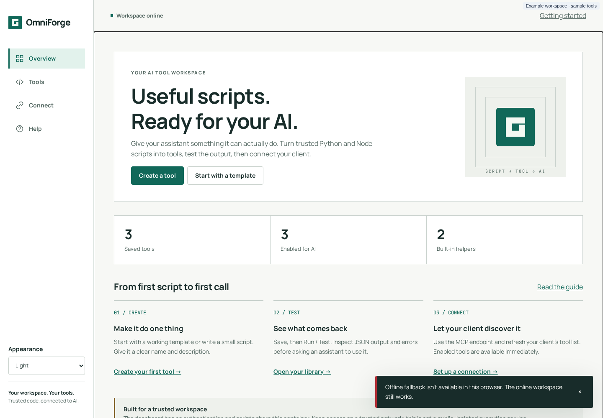

# Getting started

This page takes you from nothing to an AI client calling your first tool. It assumes Docker is installed and that you're on a network you trust. It takes about 10 minutes.

> **Before installing:** single-admin, trusted code only. The dashboard and
> management API have no login/authentication; scripts share the app environment
> and data. Keep it local/trusted and never port-forward it. This walkthrough
> describes the reviewed source; [check image provenance](Release-and-Deployment.md#published-image-inventory) before assuming tag parity.

## The idea in one paragraph

An **MCP tool** is a named action that an AI assistant can ask a server to perform. In OmniForge, each tool is a small Python or Node script. When the assistant calls the tool, OmniForge runs the script, passes it the assistant's inputs as JSON, and returns whatever the script prints. You manage the scripts in a web dashboard. AI clients find them at one address: `http://your-host:8000/mcp`.

<p align="center"></p>

## 1. Start the container

Choose a long random key first. It protects the MCP endpoint, not the dashboard:

```bash
umask 077
printf 'OMNIFORGE_API_KEY=%s\n' "$(openssl rand -hex 32)" > .env
set -a
. ./.env
set +a
```

Then start OmniForge with two named volumes, one for the database and one for package caches:

```bash
docker run -d --name omniforge \
  -p 127.0.0.1:8000:8000 \
  -e OMNIFORGE_API_KEY="$OMNIFORGE_API_KEY" \
  -v omniforge_data:/opt/omniforge/data \
  -v omniforge_lib:/opt/omniforge/lib \
  --restart unless-stopped \
  dbzocchi/omniforge:latest
```

> [!NOTE]
> Keep the generated key in a private `.env`, not in source control. It protects POST `/mcp` only; the dashboard and management API stay open. See [Security and limitations](Security-and-Limitations.md).

Other ways to install, including Compose and Unraid, are in [Installation](Installation.md).

## 2. Open the dashboard

Go to `http://localhost:8000` on the Docker host. The example intentionally does not accept connections from other hosts. You'll land on **Overview**. The top bar should say **Workspace online**.

<p align="center"></p>

## 3. Create your first tool from a template

1. Select **Start with a template**, then choose **Python greeting**. This opens the **Tool studio** with a ready-made script called `example_python_basic`.
2. Select **Save tool**. Saving stores the script; it never runs it.
3. Select **Run / Test**. With the Test inputs left as `{}`, the output panel shows something like:

   ```json
   {
     "message": "Hello from Python!",
     "utc_time": "2026-10-16T09:30:00.123456+00:00",
     "ok": true
   }
   ```

   The summary line reads **Succeeded · exit 0 · … ms**.

That tool is now **enabled**. Any MCP client that asks for the tool list will see it.

## 4. Write one of your own

Select **Create a tool**, then fill in:

| Field | Value |
|---|---|
| Tool name | `word_count` |
| Runtime | Python 3 |
| What does it do? | `Count the words in a fixed sample sentence.` |
| Script | see below |

```python
import json

text = "OmniForge turns trusted scripts into tools"
print(json.dumps({"words": len(text.split())}))
```

Save it, then run it. You should see `{"words": 6}`.

> [!IMPORTANT]
> Tools created in the dashboard take **no inputs**. The dashboard can't edit a tool's input schema yet, so it saves an empty schema, and any non-empty arguments are rejected with `Arguments do not match inputSchema`. To make a tool that accepts parameters, create it through the API or the built-in `omniforge_create_tool`. You can still edit its code in the dashboard afterwards. See [Writing tools → Giving a tool inputs](Writing-Tools.md#giving-a-tool-inputs).

## 5. Check the MCP endpoint

From a terminal, list the tools as an MCP client would:

```bash
curl -s http://localhost:8000/mcp \
  -H 'Content-Type: application/json' \
  -H "Authorization: Bearer $OMNIFORGE_API_KEY" \
  -d '{"jsonrpc":"2.0","id":1,"method":"tools/list","params":{}}'
```

You'll get the two built-in helpers (`omniforge_instructions` and `omniforge_create_tool`) plus `example_python_basic` and `word_count`. Call one:

```bash
curl -s http://localhost:8000/mcp \
  -H 'Content-Type: application/json' \
  -H "Authorization: Bearer $OMNIFORGE_API_KEY" \
  -d '{"jsonrpc":"2.0","id":2,"method":"tools/call","params":{"name":"word_count","arguments":{}}}'
```

```json
{"jsonrpc":"2.0","id":2,"result":{"content":[{"type":"text","text":"{\"words\": 6}"}],"isError":false}}
```

## 6. Connect an AI client

Open **Connect** in the dashboard to copy the endpoint, then follow [Connecting MCP clients](Connecting-MCP-Clients.md). For Claude Code, the following is an **unverified configuration**, not a compatibility guarantee:

```bash
claude mcp add --transport http omniforge http://your-host:8000/mcp \
  --header "Authorization: Bearer $OMNIFORGE_API_KEY"
```

Ask the assistant to "use the word_count tool". After you add or enable a tool, refresh the client's tool list. OmniForge doesn't send change notifications.

## What next?

- Learn the full script contract: [Writing tools](Writing-Tools.md).
- Use packages such as `requests` or `lodash`: [Dependencies](Dependencies.md).
- Tour every screen: [Dashboard guide](Dashboard-Guide.md).
- Before you leave it running: [Security and limitations](Security-and-Limitations.md) and [Backup and restore](Backup-and-Restore.md).

---

← [Home](Home.md) · [Next: Installation →](Installation.md)
