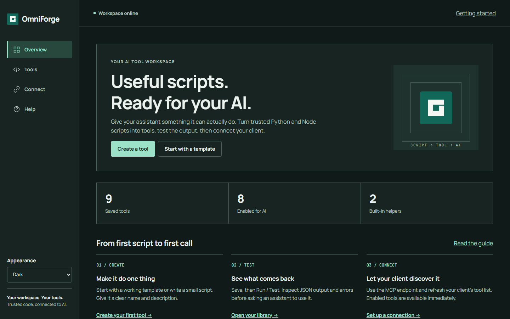

# PWA and themes

The OmniForge dashboard is an installable Progressive Web App (PWA). Installing gives it its own window and icon. It **doesn't** make OmniForge work offline: saving, running and installing packages always need the server.

## Can I install it?

Browsers only allow installation, and only run the service worker, in a **secure context**. The dashboard checks `window.isSecureContext` and doesn't register its service worker otherwise.

| How you open the dashboard | Service worker and install |
|---|---|
| `https://omniforge.your-domain.example` with a trusted certificate | Yes |
| `http://localhost:8000` or `http://127.0.0.1:8000` on the same machine | Yes (browsers treat localhost as secure) |
| `http://your-host:8000` over the LAN | **No.** The dashboard works normally but can't be installed and has no offline page |

### Installing

- **Chrome, Edge and other Chromium browsers:** select **Install app** in the dashboard's top bar when it appears, or use the browser's install icon or menu.
- **iPhone and iPad:** open the dashboard in **Safari**, then **Share → Add to Home Screen**.
- **Other browsers:** look for an install or "add to home screen" option in the menu.

After installing, OmniForge shows "OmniForge installed. Tool execution still needs the server."

### HTTPS for installation

The usual way to get HTTPS on a LAN is a reverse proxy with a certificate your devices trust. For example, with Caddy and a domain you control:

```text
omniforge.your-domain.example {
    reverse_proxy your-host:8000
}
```

> [!WARNING]
> HTTPS encrypts the connection. **It doesn't add authentication.** Keep the proxied name resolvable or reachable only inside your network, or put an IP allow-list on the proxy. Don't use proxy-level Basic auth on `/mcp`: it would collide with the `Authorization: Bearer` header MCP clients send.

## What the app stores on your device

| Store | Contents |
|---|---|
| Service worker cache `omniforge-public-v2` | Exactly 12 public files: `offline.html`, `product.css`, `mark.svg`, `favicon.svg`, `favicon-32.png`, `apple-touch-icon.png`, `icon-192.png`, `icon-512.png`, `icon-maskable-512.png`, `manifest.webmanifest`, `fonts/manrope.ttf` and `fonts/jetbrains-mono.ttf` (all under `/assets/`) |
| `localStorage` key `omniforge-theme` | `system`, `light` or `dark` |

That's all. The service worker **never caches** the dashboard HTML, anything under `/api` or `/mcp`, tool code, test inputs, results or credentials. It ignores non-GET requests, cross-origin requests and any request with an `Authorization` header. Drafts and test inputs live only in the open tab's memory.

The cached files are fetched with `credentials: 'omit'`. Redirects are refused, and each file must arrive with the expected MIME type, so a login page served by a proxy can't be cached in place of a stylesheet or font.

## Offline behaviour

- **An open tab that loses its connection** shows the banner *You're offline…*. Your draft stays in place, and Save, Run / Test, the enable switches and **Add all missing examples** are disabled until the connection returns.
- **Opening the app while offline**, or while the server is down, shows a generic **Reconnect** page from the cache, never a stale copy of your tools.
- **Navigation** is network-first. Successful pages are never stored.

## Updates

When a new version of OmniForge changes the service worker, the browser downloads it in the background and the top bar shows **Update available**.

- Nothing changes until you select **Update available**.
- If you have unsaved changes, you're asked to confirm first: *Reload to update?*
- Only the tab you accept in reloads. Other open tabs are left alone so their drafts survive. Reload them yourself when ready.

Maintainers: increment the `CACHE` name in `app/static/sw.js` (for example `omniforge-public-v2` → `v3`) whenever an allow-listed asset changes. On activation, the worker deletes only older `omniforge-public-*` caches. See [Release and deployment](Release-and-Deployment.md#service-worker-cache-version).

## Themes

Choose **Appearance** at the bottom of the desktop rail, or top right on a phone:

| Option | Behaviour |
|---|---|
| **System** (default) | Follows the operating system's light/dark setting and switches live when it changes |
| **Light** | Warm neutral canvas, dark ink text, teal accent (`#116859`) |
| **Dark** | Deep green-grey canvas (`#101a19`), light text, mint accent (`#9be2c8`) |

The choice is saved per browser in `localStorage` under `omniforge-theme`. If storage is blocked, the theme falls back to System for each visit. The browser's address-bar colour (`theme-color`) follows the theme.

<p align="center"></p>

## Type and icons

- **Manrope** for the interface and **JetBrains Mono** for code, both self-hosted under the SIL Open Font Licence (`app/static/fonts/`). No font CDN or other third-party request is made.
- The OmniForge mark is a square frame with an opening: a script entering a contained workspace and returning output. It's provided as SVG and PNG favicons, a 180 px Apple touch icon, 192 and 512 px app icons, and a 512 px maskable icon.
- Corners are 4 px at most, and the spacing follows a 4/8 px rhythm.

## Motion and accessibility

`prefers-reduced-motion` is respected. Large text, landscape phones and 44 px minimum touch targets are covered by the browser test suite. See [Dashboard guide → Accessibility](Dashboard-Guide.md#accessibility).

---

← [Home](Home.md) · [Next: Security and limitations →](Security-and-Limitations.md)
