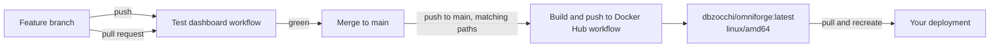

# Release and deployment

## How a release happens



There are two GitHub Actions workflows.

| Workflow | File | Runs on | Does |
|---|---|---|---|
| **Test dashboard** | `.github/workflows/test.yml` | Every pull request, and pushes to any branch **except** `main` | Checks the dashboard JavaScript syntax, runs the DOM and service-worker unit tests, builds the image and runs the Python suite inside it, and runs the Playwright browser and accessibility suite (screenshots uploaded as an artefact) |
| **Build & Push to Docker Hub** | `.github/workflows/dockerhub.yml` | Pushes to `main` that touch `Dockerfile`, `requirements.txt`, `app/**` or `.github/workflows/**`, or a manual **Run workflow** | Builds the `Dockerfile` with Buildx and pushes `dbzocchi/omniforge:latest` |

The exact test commands are in [Development and testing](Development-and-Testing.md#what-ci-runs).

Things to know:

- **Only `latest` is published.** There are no version or SHA tags and no release notes.
- **Tests don't run on the push to `main`.** The image is built from whatever lands on `main`. Merge through a pull request so the tests have run first.
- Changes only to docs, tests or `docker-compose.yml` **don't** trigger a new image.
- The image is built for **`linux/amd64`** only. The build step doesn't set `platforms`.
- Python dependencies in `requirements.txt` are unpinned, so two builds of the same commit can differ.
- Docker Hub credentials come from the repository secrets `DOCKERHUB_USERNAME` and `DOCKERHUB_TOKEN`.

## Pin by digest for reproducible deploys

`latest` moves every time `main` changes. To know exactly what you're running, and to roll back, deploy by **digest**.

Find the digest of the current `latest`:

```bash
docker buildx imagetools inspect dbzocchi/omniforge:latest
# or, after a pull:
docker image inspect --format '{{index .RepoDigests 0}}' dbzocchi/omniforge:latest
```

Use it in Compose:

```yaml
services:
  omniforge:
    image: dbzocchi/omniforge@sha256:<digest-from-above>
```

Or with `docker run`:

```bash
docker run -d --name omniforge … dbzocchi/omniforge@sha256:<digest>
```

Record each digest you deploy, with the date, so you have a list of rollback targets.

## Updating

1. **Back up** the database ([Backup and restore](Backup-and-Restore.md)).
2. Pull and recreate:

   ```bash
   # Compose, tracking latest
   docker compose pull && docker compose up -d

   # Compose, pinned: change the digest in compose.yaml, then
   docker compose up -d

   # docker run
   docker pull dbzocchi/omniforge:latest
   docker stop omniforge && docker rm omniforge
   docker run -d --name omniforge …same flags as before… dbzocchi/omniforge:latest
   ```

   On Unraid, use **Check for Updates → Apply update**.
3. Open the dashboard. If the service worker changed, **Update available** appears. Accept it in one tab and reload any others.
4. Run one or two tools from the dashboard to confirm they still work.

There are no database migrations. The schema is created if it's missing and otherwise left alone, so updates and downgrades don't touch your data.

## Rolling back

Redeploy the previous digest:

```bash
docker compose down
# set image: dbzocchi/omniforge@sha256:<previous-digest>
docker compose up -d
```

Older digests usually stay pullable after `latest` moves on. Docker Hub doesn't promise to keep untagged images forever, though. If a known-good version matters to you, keep a copy:

```bash
docker save dbzocchi/omniforge@sha256:<digest> | gzip > omniforge-<date>.tar.gz
# restore later with
docker load < omniforge-<date>.tar.gz
```

## Building and pushing by hand

CI normally does this, but it works from any machine logged in to Docker Hub with push rights:

```bash
docker buildx build --platform linux/amd64 -t dbzocchi/omniforge:latest --push .
```

To keep a build local for testing, use `--load -t omniforge:dev` instead of `--push`.

## Service worker cache version

The PWA caches 12 public assets under the cache name in `app/static/sw.js`:

```javascript
const CACHE = 'omniforge-public-v2';
```

**If a release changes any allow-listed asset** (`product.css`, icons, fonts, `offline.html` or the manifest), increment this name, for example to `omniforge-public-v3`. Otherwise installed apps keep serving the old files. On activation, the new worker deletes older `omniforge-public-*` caches. Users see **Update available** and choose when to reload.

Changes to `dashboard.html` alone don't need a bump, because the dashboard is never cached.

## Release checklist

- [ ] Pull request opened and **Test dashboard** passed, including the browser job.
- [ ] Service-worker `CACHE` name bumped if any public asset changed.
- [ ] `README.md` and `docs/wiki/` updated for behaviour changes.
- [ ] Merged to `main`, and **Build & Push to Docker Hub** finished.
- [ ] New digest recorded. Deployment updated, then checked.

---

← [Home](Home.md) · [Next: Architecture →](Architecture.md)
