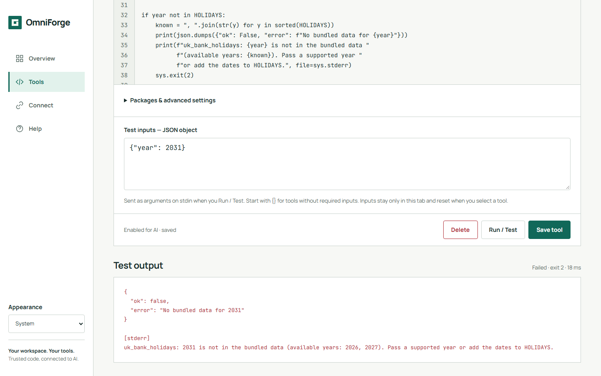

# Testing tools

Test a tool before you hand it to an AI. You can do it in three ways, and all three run the same saved code with the same validation:

| Where | Use it for |
|---|---|
| Dashboard **Run / Test** | Day-to-day checks while writing. Shows stdout, stderr, exit code and duration. |
| `POST /api/tools/{name}/run` | Scripts, CI checks, or anything that doesn't need MCP framing. |
| `POST /mcp` with `tools/call` | Seeing exactly what an AI client will receive. |

> [!NOTE]
> Every test **really runs the script**. Side effects such as API calls, file writes and emails all happen. There's no dry-run mode.

## In the dashboard

1. Open the tool in the **Tool studio** and **Save** any changes. Run / Test always uses the saved version and stays disabled while you have unsaved edits.
2. In **Test inputs**, enter a JSON object. Leave it as `{}` for tools without inputs. For a tool with a schema, enter something like `{"net": 99.99}`.
3. Select **Run / Test**.

<p align="center"></p>

Reading the result:

- The **summary**, for example `Succeeded · exit 0 · 182 ms`, gives the outcome, the exit code and the wall-clock time including any package install.
- **Output** shows stdout, pretty-printed when it's JSON, and then `[stderr]` with anything written to stderr.
- **Previous version / inputs** before the summary means the code, the saved revision or the inputs have changed since that run. Run again to get a current result.

Common messages:

| Message | Meaning |
|---|---|
| *Enter a valid JSON object, for example …* | Test inputs must be a JSON **object**. Arrays, `null`, strings and numbers are rejected in the browser. |
| *HTTP 422: Arguments do not match inputSchema* | Valid JSON, but it doesn't match the saved schema. Dashboard-created tools accept only `{}`. |
| *HTTP 412: Changed in another tab/client; draft retained…* | The tool changed since you opened it. Copy your draft, then reload from the library. |
| *Preparing dependencies… First installation may take up to 120 seconds…* | The first run of a tool with packages. Wait for it to finish. |

<p align="center"></p>

Test inputs are deliberately temporary. They're not saved with the tool or in browser storage, and they reset to `{}` when you open a different tool.

## With the REST API

```bash
curl -s -X POST http://localhost:8000/api/tools/add_vat/run \
  -H 'Content-Type: application/json' \
  -d '{"arguments": {"net": 99.99}}'
```

```json
{
  "stdout": "{\"net\": \"99.99\", \"rate\": \"20\", \"vat\": \"20.00\", \"gross\": \"119.99\"}",
  "stderr": "",
  "exit_code": 0,
  "timed_out": false,
  "duration_ms": 41
}
```

- Leave out the body entirely to run with `{}`.
- The body must be exactly `{"arguments": {…}}`. Any other key returns HTTP 422.
- Add `If-Match: <revision>` to make sure you're testing the version you think you are. If the tool changed, you get HTTP 412 and nothing runs.
- This route runs **disabled** tools too. Disabling a tool only hides it from MCP.
- No API key is needed. The management API has no authentication.

## Over MCP

```bash
curl -s http://localhost:8000/mcp \
  -H 'Content-Type: application/json' \
  -H 'Authorization: Bearer <YOUR_API_KEY>' \
  -d '{"jsonrpc":"2.0","id":1,"method":"tools/call","params":{"name":"add_vat","arguments":{"net":99.99}}}'
```

```json
{"jsonrpc":"2.0","id":1,"result":{"content":[{"type":"text","text":"{\"net\": \"99.99\", \"rate\": \"20\", \"vat\": \"20.00\", \"gross\": \"119.99\"}"}],"isError":false}}
```

Differences from the REST route:

- Only **enabled** tools can be called. A disabled or unknown name returns `isError: true` with `Unknown or inactive tool`.
- stderr, exit code and timeout markers are folded into the text (see [Writing tools → Errors](Writing-Tools.md#errors-stderr-and-exit-codes)).
- Validation errors come back as `isError: true` results, not HTTP errors.

## A testing checklist

- [ ] Runs with the smallest valid input, and with every optional field filled in.
- [ ] Bad input is rejected by the schema, not by a crash in the script.
- [ ] Upstream failures (network down, HTTP 500) print a clear message to stderr and exit non-zero.
- [ ] Successful runs write **nothing** to stderr, so MCP clients get clean JSON.
- [ ] Output is small: kilobytes, not megabytes.
- [ ] Runs well within 45 s, including any network calls, which should have their own timeouts.
- [ ] Packages are pinned, and the first run has completed so the cache is warm.
- [ ] Nothing in the code or the output contains a secret.

## Automated checks for your own tools

OmniForge has no test runner for user tools, but the REST route is easy to script:

```bash
#!/usr/bin/env bash
set -euo pipefail
result=$(curl -sf -X POST http://localhost:8000/api/tools/add_vat/run \
  -H 'Content-Type: application/json' -d '{"arguments":{"net":10}}')
echo "$result" | jq -e '.exit_code == 0 and (.stdout | fromjson | .gross == "12.00")' > /dev/null \
  && echo "add_vat: ok"
```

---

← [Home](Home.md) · [Next: Connecting MCP clients →](Connecting-MCP-Clients.md)
